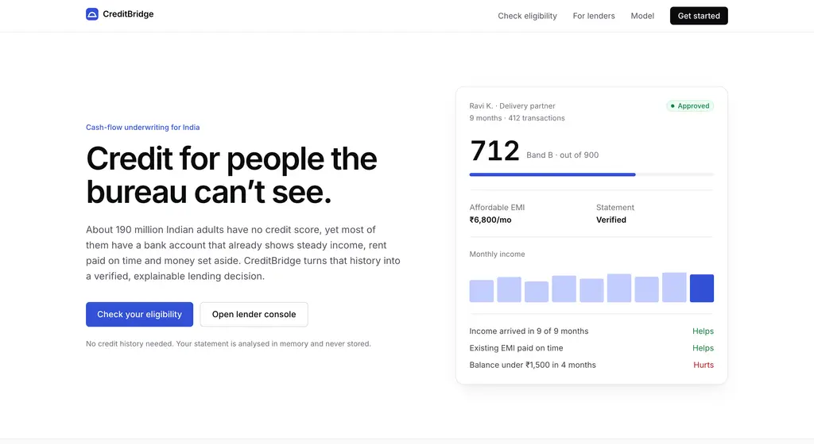
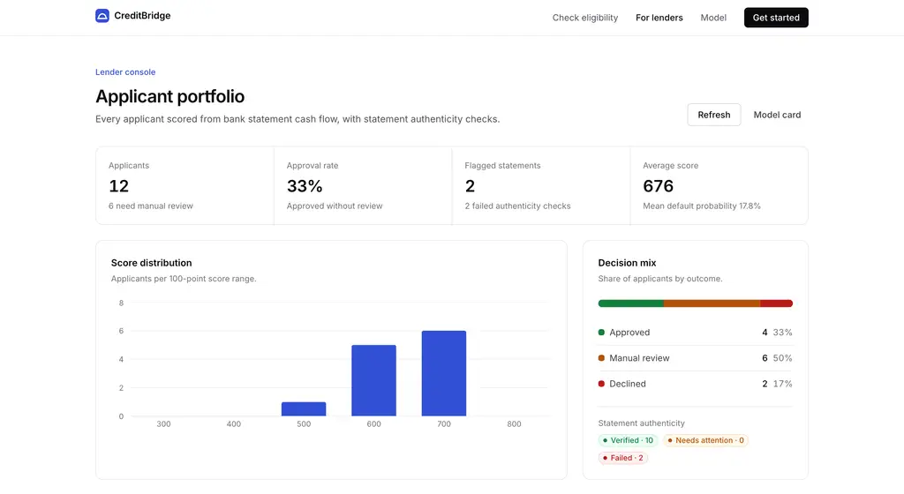
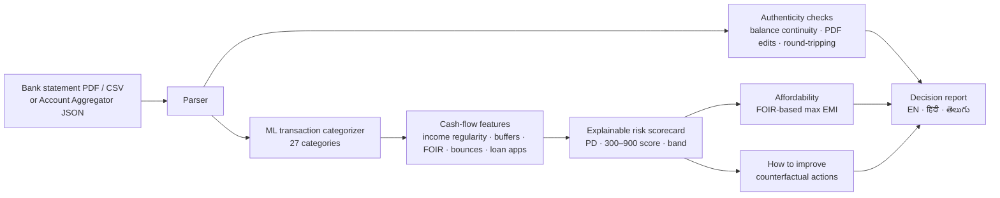

# CreditBridge — Cash-flow credit scoring for India's credit-invisible

**Neural Storm 2026 · Track 3: Human Impact · Problem statement HI-04 — Alternative Credit Scoring for the Unbanked**

**Live:** https://creditbridge-bay.vercel.app · **Repo:** https://github.com/Aryan1982/creditbridge

**Team:** CreditBridge — Aryan Thakor (solo)


| Landing | Lender console |
|---|---|
|  |  |

## Problem

About 190 million Indian adults have no usable credit score. Lenders decide from bureau history, so gig workers, shopkeepers, farmers, students and homemakers are refused or pushed to instant-loan apps — even when their bank account shows years of steady income and on-time bills.

The evidence already exists in their **bank statements and UPI history**, but lenders can't use it:
1. Statements are thousands of cryptic narrations (`UPI/DR/412345678901/SWIGGY/YESB/...`), unreadable at scale.
2. Statements are easily **forged** — edited PDFs and money round-tripped between friends to fake income.
3. There is no explainable, auditable way to turn cash flow into a credit decision.

## Solution

CreditBridge turns 6–12 months of bank data into an explainable credit decision in seconds:



| Surface | Who | What |
|---|---|---|
| `/check` | Borrower | Upload a statement, connect via Account Aggregator consent, or try a sample profile; choose a loan; watch the pipeline run |
| `/report` | Borrower / officer | Score, band and decision; requested vs affordable EMI; reason codes; how to improve; cash flow, income sources, spending, categorized transactions, authenticity evidence; EN/HI/TE; printable decision letter |
| `/lender` | NBFC / MFI credit team | Portfolio of applicants with score, decision, affordability and flagged statements; drill into any report |
| `/model` | Risk / compliance | Model card: accuracy, calibration, ablations, per-persona performance, fairness, external validation, limitations |

## What makes it hard (and how we solved it)

**1. No public data exists** for Indian bank statements with repayment outcomes. We built a persona-based simulator (`ml/simulator.py`): salaried, gig workers, shopkeepers, farmers, students and homemakers with bank-specific narration formats (SBI, HDFC, ICICI, Axis, Kotak, Canara, BoB, PNB), truncation and typos. Hidden traits (money discipline, repayment priority, income-shock risk, liquidity stress, betting and loan-app propensity) drive what appears in the statement. **Default is simulated over a separate future 12-month window from hidden traits plus fresh shocks and noise**, so the model has to infer risk, not read it off a column.

**2. Narration understanding.** Char 3–5-gram + word TF-IDF → multinomial logistic regression over 27 categories. Evaluated on **merchants never seen in training**: about 25% of the merchants in each category are held out entirely (33,115 test narrations, 33% of rows), to measure generalisation, not memorisation.

**3. Fraud-resistant input.** Every statement goes through authenticity checks before scoring: running-balance continuity (catches edited amounts; rows without a printed balance are carried forward, not flagged), duplicate transaction IDs, date gaps, salary consistency, statement length, PDF metadata and **round-tripping** (credits returned to the same counterparty within 72 h). Round-tripping fails when returned credits are ≥10% of money in across ≥2 pairs, or a single return is ≥25%; smaller back-and-forth between friends is only a warning, and returned credits never count as income. PDF-editor traces alone (e.g. re-saved in iLovePDF to remove a password) are a warning; they fail only when the balance or salary checks corroborate tampering. A failed check blocks auto-approval and shows the evidence rows.

**4. Explainability by construction.** The deployed model is a **sign-constrained L2 logistic scorecard**: every coefficient is constrained to the direction lending logic expects (or exactly zero) and fit by L-BFGS-B on standardized features, so collinearity can never produce a reversed reason code. Scaling and selection are refit inside each CV fold. Every decision decomposes exactly into per-feature contributions, which become reason codes and drive the counterfactual "how to improve" search.

**5. Policy guardrails.** Statements covering under 90 days or with fewer than 30 transactions are never auto-approved (amount capped at ₹25,000); statements with under ₹1,000 a month of regular income are outside the training population and declined; failed authenticity checks block auto-approval. Approve/review cut-offs are fixed PD limits (approve ≤ 11%, review ≤ 22%) set as policy, not tuned on outcomes.

**6. Serverless, private, numpy-only runtime.** Training uses scikit-learn and SciPy; models are exported to JSON and re-implemented in numpy for inference, with parity asserted at train time (categorizer max diff 5.9e-6, scorecard 3.5e-8). Nothing is stored server-side.

## Results

All risk metrics are 5-fold stratified CV, out-of-fold, on 6,000 simulated applicants (2,852,088 transactions, 19.9% default rate). All three risk models use the same 17 candidate features and the same folds.

**Transaction categorizer**

| Evaluation | Accuracy | Macro-F1 |
|---|---|---|
| Unseen merchants (~25% of merchants per category held out) | **0.860** | 0.797 |
| Same-population statements | 0.988 | — |

**Risk model**

| Model | ROC-AUC | KS | Gini | Brier |
|---|---|---|---|---|
| Sign-constrained logistic scorecard (**deployed**, explainable) | **0.718** | 0.334 | 0.436 | 0.146 |
| WoE-binned scorecard | 0.726 | 0.343 | 0.452 | 0.142 |
| HistGradientBoosting | 0.723 | 0.354 | 0.446 | 0.144 |

The deployed scorecard gives up 0.005–0.008 AUC against the black-box benchmarks in exchange for exact, never-reversed reason codes.

**Ablations — what cash flow adds**

| Feature set | Features | ROC-AUC |
|---|---|---|
| Bureau-like (has existing EMI + any bounce) | 2 | 0.609 |
| Income only (level, variability, regularity, sources) | 4 | 0.558 |
| Cash flow without balance features | 14 | 0.714 |
| Full cash-flow candidate set (deployed) | 17 | **0.718** |

**Score bands are monotonic** — observed default rate A 3.7% → B 7.1% → C 13.1% → D 25.5% → E 44.1%. Policy: 21.6% auto-approved (6.6% default), 31.9% declined (35.4% default), the rest routed to review.

**By persona** (AUC): gig worker 0.747, salaried 0.726, homemaker 0.720, student 0.720, shopkeeper 0.697, farmer 0.650.

**Top drivers:** bill-payment regularity, savings rate, share of income already going to EMIs (FOIR), instant-loan-app use, bounced payments, balance left before income arrives, betting spend. In the simulated population, income level adds little once repayment behaviour is known; income mainly sets how much can be lent (EMI capped at a share of income).

**Fairness.** Gender is never a model input; it is simulated only to audit outcomes. Approval rate female 22.8% vs male 21.0%; approval among those who repaid 25.7% vs 25.0%.

**External validation on real data.** On the real Statlog German Credit dataset (1,000 applicants, `ml/validate_german_credit.py`), non-bureau features alone reach AUC 0.751 vs 0.625 for bureau features alone. On the 89 applicants with no or fully-paid prior credit, alternative data reaches 0.682 while bureau features carry no usable signal (0.338). Caveats: that subset is defined by a bureau field, so the bureau model is nearly constant inside it, and n is small — treat it as directional.

## Tests

```bash
.venv/bin/python -m pytest      # 107 tests: parsers, authenticity checks, scoring invariants, API
npm run lint && npm run typecheck && npm run build
```

Tests cover every sample format parsing identically, genuine statements passing and tampered ones failing with evidence, a single edited amount breaking balance continuity, reason codes summing exactly to the model logit, improvements raising the score, affordability caps, runtime never importing training libraries, and readable 400s for bad input. GitHub Actions runs the Python and web checks on every push (`.github/workflows/ci.yml`).

## Tech stack

- **ML / backend (Python):** scikit-learn, pandas, numpy (training); numpy, FastAPI, pdfplumber (runtime); reportlab (sample PDF generation)
- **Frontend:** Next.js 16 (App Router), React 19, TypeScript, Tailwind CSS 4, Recharts
- **Deployment:** Vercel (Next.js + Python serverless function)
- **Demo video:** Remotion (`video/`)

## Setup and running locally

Requirements: Python 3.12, Node 20+.

```bash
git clone https://github.com/Aryan1982/creditbridge && cd creditbridge

# Python
python3.12 -m venv .venv
.venv/bin/pip install -r requirements-dev.txt

# Optional: retrain everything (simulator → categorizer → risk model → model card → samples), ~2 min
.venv/bin/python ml/train_all.py
.venv/bin/python ml/make_sample_variants.py   # PDF / Account Aggregator / tampered sample statements

# API (terminal 1)
.venv/bin/uvicorn api.index:app --port 8000

# Web app (terminal 2)
npm install
npm run dev
# open http://localhost:3000
```

Try it: on `/check` pick **Priya Sharma — edited PDF** to see a forged statement caught, or **Ravi Kumar — round-tripped funds** to see fake income removed. Upload any file from `data/samples/`.

## API

| Method | Path | Description |
|---|---|---|
| GET | `/api/health` | Liveness |
| GET | `/api/samples` | Sample applicant statements |
| POST | `/api/analyze` | Multipart `file` or `sample_id`, plus `loan_amount`, `tenure_months`, `purpose` → full report |
| POST | `/api/portfolio` | Scores every sample for the lender console |
| GET | `/api/model-card` | Model card |

## Repository layout

```
ml/                 offline training: simulator, categorizer, risk model, model card, samples, German Credit validation
engine/             numpy-only runtime: parse, integrity, categorize, features, score, analyze
engine/models/      exported model JSON + model card
api/index.py        FastAPI app (Vercel Python function)
app/ components/ lib/  Next.js frontend
data/samples/       sample statements (CSV, PDF, Account Aggregator JSON, tampered variants)
video/              Remotion demo video composition
```

## Limitations and responsible use

- **Prototype, not a lending product.** The risk model is trained on simulated statements; it must be re-fitted and validated on real repayment outcomes before real decisions.
- Unseen merchants are categorised less accurately (shopping, fuel/transport are the weakest classes; see `/model`).
- Cash deposits and transfers from individuals can't be verified as income and are counted conservatively.
- Seasonal income (harvests) may be under-represented in six months of history; farm income is judged on the average month.
- Fairness was audited on simulated labels only.
- Scores cover repayment risk from cash flow; identity/KYC checks are out of scope.

## AI tools disclosure

Developed with AI coding assistants (Claude, via a coding-agent CLI) for code generation, documentation and the Remotion video composition. All metrics were produced by running the code in this repository.
