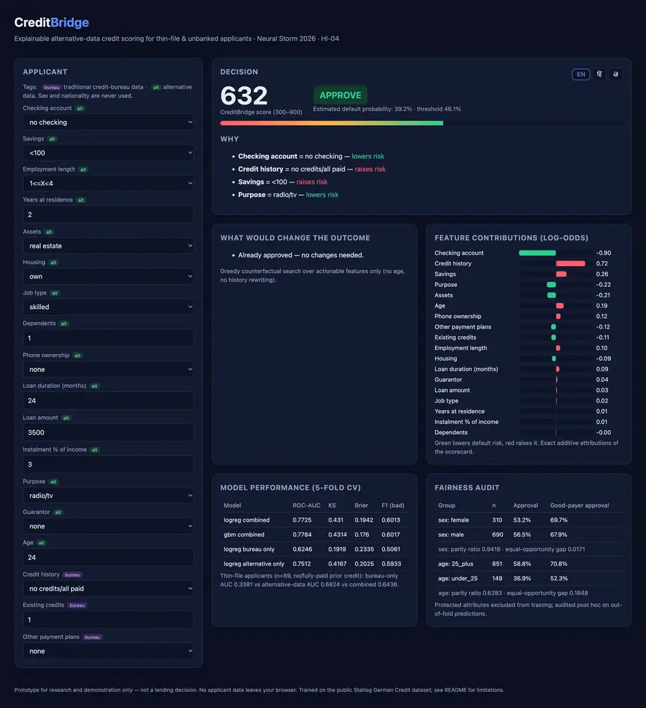
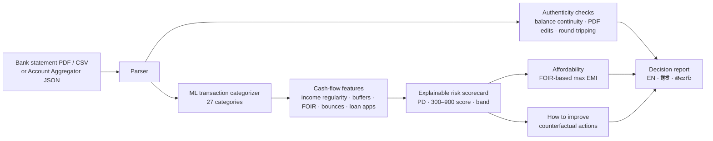

# CreditBridge — Cash-flow credit scoring for India's credit-invisible

**Neural Storm 2026 · Track 3: Human Impact · Problem statement HI-04 — Alternative Credit Scoring for the Unbanked**

**Live:** https://creditbridge-bay.vercel.app · **Repo:** https://github.com/Aryan1982/creditbridge

**Team:** CreditBridge — Aryan Thakor (solo)



## Problem

About 190 million Indian adults have no usable credit score. Lenders decide from bureau history, so gig workers, shopkeepers, farmers, students and homemakers are refused or pushed to instant-loan apps — even when their bank account shows years of steady income and on-time bills.

The evidence already exists in their **bank statements and UPI history**, but lenders can't use it:
1. Statements are thousands of cryptic narrations (`UPI/DR/412345678901/SWIGGY/YESB/...`), unreadable at scale.
2. Statements are easily **forged** — edited PDFs and money round-tripped between friends to fake income.
3. There is no explainable, auditable way to turn cash flow into a credit decision.

## Solution

CreditBridge turns 6–12 months of bank data into an explainable credit decision in seconds:



| Surface | Who | What |
|---|---|---|
| `/check` | Borrower | Upload a statement, connect via Account Aggregator consent, or try a sample profile; choose a loan; watch the pipeline run |
| `/report` | Borrower / officer | Score, band and decision; requested vs affordable EMI; reason codes; how to improve; cash flow, income sources, spending, categorized transactions, authenticity evidence; EN/HI/TE; printable decision letter |
| `/lender` | NBFC / MFI credit team | Portfolio of applicants with score, decision, affordability and flagged statements; drill into any report |
| `/model` | Risk / compliance | Model card: accuracy, calibration, ablations, per-persona performance, fairness, external validation, limitations |

## What makes it hard (and how we solved it)

**1. No public data exists** for Indian bank statements with repayment outcomes. We built a persona-based simulator (`ml/simulator.py`): salaried, gig workers, shopkeepers, farmers, students and homemakers with bank-specific narration formats (SBI, HDFC, ICICI, Axis, Kotak, Canara, BoB, PNB), truncation and typos. Hidden traits (money discipline, repayment priority, income-shock risk, liquidity stress, betting and loan-app propensity) drive what appears in the statement. **Default is simulated over a separate future 12-month window from hidden traits plus fresh shocks and noise**, so the model has to infer risk, not read it off a column.

**2. Narration understanding.** Char 3–5-gram + word TF-IDF → multinomial logistic regression over 27 categories. Evaluated on **merchants never seen in training** (25% of merchants per category held out) to measure generalisation, not memorisation.

**3. Fraud-resistant input.** Every statement goes through authenticity checks before scoring: running-balance continuity (catches edited amounts), duplicate transaction IDs, date gaps, PDF metadata (edited after creation, known PDF-editor producers), **round-tripping** (credit from a counterparty returned within 72 h — fake income is excluded), salary consistency and statement length. A failed check blocks auto-approval and shows the evidence rows.

**4. Explainability by construction.** The deployed model is a sign-constrained standardized logistic scorecard: every decision decomposes exactly into per-feature contributions, which become reason codes and drive the counterfactual "how to improve" search. Features whose fitted effect contradicted domain logic were dropped so no reason code is ever nonsensical.

**5. Serverless, private, numpy-only runtime.** Training uses scikit-learn; models are exported to JSON and re-implemented in numpy for inference, with parity asserted at train time (categorizer max diff 5.9e-6, scorecard 4.0e-8). Nothing is stored server-side.

## Results

All risk metrics are 5-fold stratified CV, out-of-fold, on 6,000 simulated applicants (2,852,088 transactions, 20.2% default rate).

**Transaction categorizer**

| Evaluation | Accuracy | Macro-F1 |
|---|---|---|
| Unseen merchants (held-out 25% per category) | **0.860** | 0.797 |
| Same-population statements | 0.988 | — |

**Risk model**

| Model | ROC-AUC | KS | Gini | Brier |
|---|---|---|---|---|
| Logistic scorecard (**deployed**, explainable) | **0.719** | 0.329 | 0.439 | 0.146 |
| WoE-binned scorecard | 0.728 | 0.349 | 0.455 | 0.143 |
| HistGradientBoosting | 0.717 | 0.328 | 0.434 | 0.146 |

**Ablations — what cash flow adds**

| Feature set | ROC-AUC |
|---|---|
| Bureau-like (has existing EMI + any bounce) | 0.614 |
| Income only (level, variability, regularity) | 0.545 |
| Cash flow without balance features | 0.711 |
| Full cash-flow scorecard | **0.719** |

**Score bands are monotonic** — observed default rate A 6.3% → B 7.2% → C 13.4% → D 24.3% → E 44.6%. Policy: 23.7% auto-approved (7.0% default), 33.5% declined (35.6% default), the rest routed to review.

**By persona** (AUC): gig worker 0.745, student 0.736, salaried 0.732, homemaker 0.709, shopkeeper 0.708, farmer 0.649.

**Top drivers:** savings buffer (months of income), bill-payment regularity, share of income already going to EMIs (FOIR), savings rate, instant-loan-app use, bounced payments, income variability.

**Fairness.** Gender is never a model input; it is simulated only to audit outcomes. Approval rate female 25.4% vs male 22.9%; approval among those who repaid 28.6% vs 27.1%.

**External validation on real data.** On the real Statlog German Credit dataset (1,000 applicants, `ml/validate_german_credit.py`), non-bureau features alone reach AUC 0.751 vs 0.625 for bureau features alone; on thin-file applicants the bureau-only model is worse than random (0.338) while alternative data reaches 0.682.

## Tech stack

- **ML / backend (Python):** scikit-learn, pandas, numpy (training); numpy, FastAPI, pdfplumber (runtime); reportlab (sample PDF generation)
- **Frontend:** Next.js 16 (App Router), React 19, TypeScript, Tailwind CSS 4, Recharts
- **Deployment:** Vercel (Next.js + Python serverless function)
- **Demo video:** Remotion (`video/`)

## Setup and running locally

Requirements: Python 3.12, Node 20+.

```bash
git clone https://github.com/Aryan1982/creditbridge && cd creditbridge

# Python
python3.12 -m venv .venv
.venv/bin/pip install -r requirements-dev.txt

# Optional: retrain everything (simulator → categorizer → risk model → model card → samples), ~2 min
.venv/bin/python ml/train_all.py
.venv/bin/python ml/make_sample_variants.py   # PDF / Account Aggregator / tampered sample statements

# API (terminal 1)
.venv/bin/uvicorn api.index:app --port 8000

# Web app (terminal 2)
npm install
npm run dev
# open http://localhost:3000
```

Try it: on `/check` pick **Priya Sharma — edited PDF** to see a forged statement caught, or **Ravi Kumar — round-tripped funds** to see fake income removed. Upload any file from `data/samples/`.

## API

| Method | Path | Description |
|---|---|---|
| GET | `/api/health` | Liveness |
| GET | `/api/samples` | Sample applicant statements |
| POST | `/api/analyze` | Multipart `file` or `sample_id`, plus `loan_amount`, `tenure_months`, `purpose` → full report |
| POST | `/api/portfolio` | Scores every sample for the lender console |
| GET | `/api/model-card` | Model card |

## Repository layout

```
ml/                 offline training: simulator, categorizer, risk model, model card, samples, German Credit validation
engine/             numpy-only runtime: parse, integrity, categorize, features, score, analyze
engine/models/      exported model JSON + model card
api/index.py        FastAPI app (Vercel Python function)
app/ components/ lib/  Next.js frontend
data/samples/       sample statements (CSV, PDF, Account Aggregator JSON, tampered variants)
video/              Remotion demo video composition
```

## Limitations and responsible use

- **Prototype, not a lending product.** The risk model is trained on simulated statements; it must be re-fitted and validated on real repayment outcomes before real decisions.
- Unseen merchants are categorised less accurately (shopping, fuel/transport are the weakest classes; see `/model`).
- Cash deposits and transfers from individuals can't be verified as income and are counted conservatively.
- Seasonal income (harvests) may be under-represented in six months of history; farm income is judged on the average month.
- Fairness was audited on simulated labels only.
- Scores cover repayment risk from cash flow; identity/KYC checks are out of scope.

## AI tools disclosure

Developed with AI coding assistants (Claude, via a coding-agent CLI) for code generation, documentation and the Remotion video composition. All metrics were produced by running the code in this repository.
