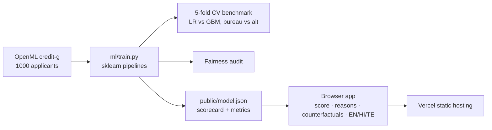

# CreditBridge — Explainable Alternative-Data Credit Scoring for the Unbanked

**Neural Storm 2026 · Track 3: Human Impact · Problem statement HI-04 (Alternative Credit Scoring for the Unbanked)**

**Live demo:** https://creditbridge-bay.vercel.app · **Repo:** https://github.com/Aryan1982/creditbridge

**Team:** CreditBridge — Aryan Thakor (solo)


## Problem

Roughly 190 million Indian adults have no usable credit score. Lenders score people from credit-bureau records (repayment history, existing loans), so "thin-file" applicants — students, gig workers, first-time borrowers — are rejected or priced out regardless of how reliable they really are. When they *are* scored, they get no explanation and no path to approval.

## Solution

CreditBridge scores applicants from **alternative data** (banking behaviour, savings, employment and housing stability, phone ownership, assets, loan structure) alongside any bureau data that exists, and makes every decision explainable:

- **Score + decision** — 300–900 CreditBridge score with an approve/refer decision at a Youden-optimal cut-off.
- **Reason codes** — the top drivers of each decision, exact additive attributions of the scorecard (equivalent to SHAP values for a linear model).
- **Counterfactuals** — "what would get you approved": greedy search over *actionable* features only (loan amount, duration, savings, guarantor…), never age or history.
- **Multilingual** — explanations in English, Hindi (हिंदी) and Telugu (తెలుగు).
- **Fairness audit** — sex and nationality are excluded from training; approval-rate parity and equal-opportunity gaps are audited by sex and age.
- **Privacy** — scoring runs entirely in the browser from an exported model JSON; no applicant data is sent anywhere.

## Results (5-fold stratified CV, out-of-fold predictions)

| Model | ROC-AUC | KS | Brier | F1 (default class) |
|---|---|---|---|---|
| Logistic scorecard, bureau + alternative (**deployed**) | **0.773** | 0.431 | 0.194 | 0.601 |
| Gradient boosting, bureau + alternative (benchmark) | 0.778 | 0.431 | 0.176 | 0.602 |
| Logistic, bureau features only | 0.625 | 0.192 | 0.234 | 0.506 |
| Logistic, alternative features only | 0.751 | 0.417 | 0.203 | 0.593 |

**Key finding:** alternative data alone (AUC 0.751) beats bureau data alone (0.625) by +0.13 AUC. On **thin-file applicants** (n = 89, no/fully-paid prior credit), the bureau-only model is worse than random (AUC 0.338) while the alternative-data model reaches **0.682**.

The deployed scorecard is within 0.006 AUC of gradient boosting while staying fully transparent, so we ship the scorecard. The exported JSON model is checked against sklearn at train time (max probability drift 1.3e-4).

**Fairness (out-of-fold):**

| Group | Approval rate | Good-payer approval rate |
|---|---|---|
| Female (n=310) | 53.2% | 69.7% |
| Male (n=690) | 56.5% | 67.9% |
| Age 25+ (n=851) | 58.8% | 70.8% |
| Age <25 (n=149) | 36.9% | 52.3% |

Sex: parity ratio 0.94, equal-opportunity gap 0.017 — within the 0.8 four-fifths rule. **Age: parity ratio 0.63 — fails the four-fifths rule.** Younger applicants are disadvantaged; this is the top item under limitations.

## Architecture



## Tech stack

- **Python 3.9+** — scikit-learn (LogisticRegression, HistGradientBoostingClassifier, ColumnTransformer), pandas, numpy
- **Frontend** — plain HTML/CSS/JavaScript; no framework, runs the exported model client-side
- **Deployment** — Vercel (static)
- **Demo video** — Remotion composition in `video/`

## Dataset

Statlog German Credit (UCI / OpenML `credit-g`): 1,000 applicants, 20 attributes, 30% default rate. Features are grouped into *bureau* (`credit_history`, `existing_credits`, `other_payment_plans`) and *alternative* (all others). `personal_status` (encodes sex) and `foreign_worker` are excluded from the model and used only for auditing.

## Setup and running locally

```bash
git clone https://github.com/Aryan1982/creditbridge && cd creditbridge
python3 -m pip install -r requirements.txt
python3 ml/train.py           # downloads data, benchmarks models, writes public/model.json
python3 -m http.server -d public 8000
# open http://localhost:8000
```

Deploy: `npx vercel deploy --prod` (serves `public/` as static files, see `vercel.json`).

Demo video: see `video/README.md` (`cd video && npm install && npm run studio`).

## Repository layout

```
ml/train.py        training, benchmarking, fairness audit, model export
public/index.html  app UI
public/app.js      client-side scoring, reason codes, counterfactuals, translations
public/model.json  exported scorecard + all metrics (generated)
video/             Remotion demo video composition
docs/              screenshots
```

## Limitations and responsible use

- **Not a lending product.** Research prototype; decisions must not be used for real credit.
- **Age disparity**: under-25 applicants have a parity ratio of 0.63. A production system would need reweighting or threshold adjustment and regulatory review.
- **Dataset**: German Credit is small (1,000 rows) and dated (1994). It stands in for Indian alternative data (UPI transactions, utility and mobile recharge payments), which isn't publicly available. The pipeline is feature-agnostic and can be retrained on such data.
- Thin-file AUC is measured on only 89 applicants, so it has wide confidence intervals.
- Hindi and Telugu strings are template translations of feature names and decisions, not free-form generated text.

## AI tools disclosure

This project was developed with the help of AI coding assistants (Claude via a coding-agent CLI) for code generation, the README and the Remotion video composition. All results were produced by running the code in this repository.
